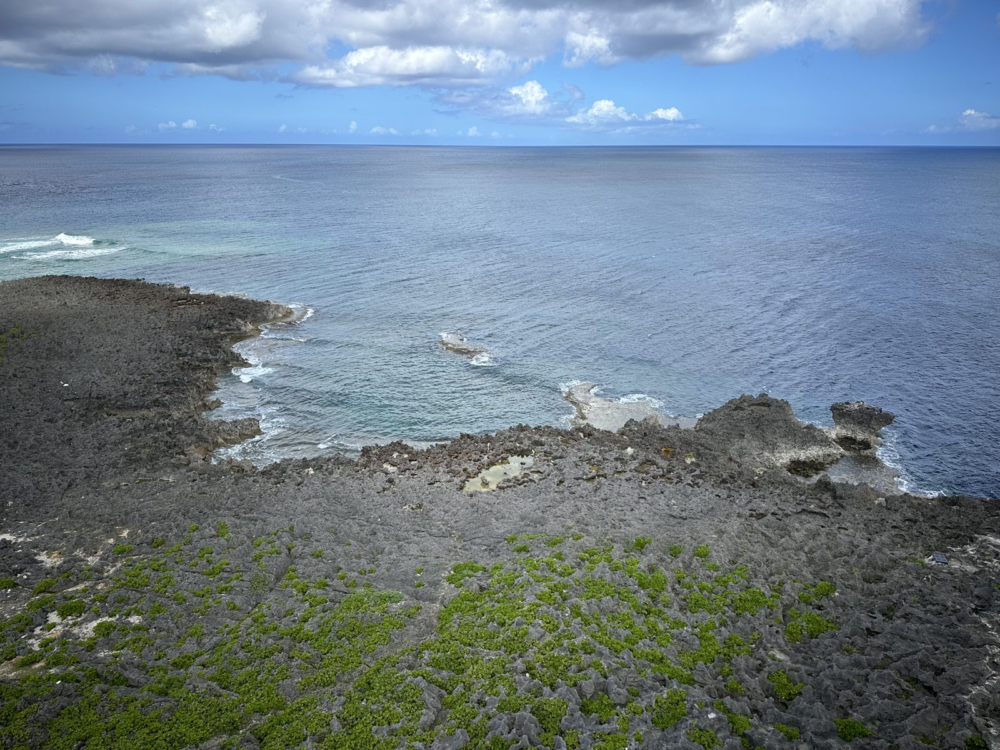

中部西海岸的景點沿著 58 號國道排成一條線。**從北邊的恩納開始，一路往南玩回北谷**，晚上在美國村看完夕陽，回那霸只要 30 分鐘。

## 上午：萬座毛

像大象鼻子的斷崖，下面的海是一層一層的藍。早上九點前人少，光線也順。步道一圈大約 20 分鐘，入口有停車場和小賣店。

## 中午：殘波岬

讀谷村最西邊的岬角，白色燈塔旁邊是一整排斷崖。風很大，帽子要壓好。燈塔可以付費爬上去，看完一圈大約 30 分鐘。附近的殘波岬公園有大草地和一隻很大的風獅爺。

## 下午：讀谷やちむんの里

十幾間陶器工房聚在同一片樹林裡，中間有一座很長的登窯。各家風格不同，**逛的時候可以問能不能拿起來看**，大部分店家很樂意。買大件的可以問寄送，但國際運費要先問清楚。

## 傍晚前：港川外人住宅

以前給美軍家屬住的白色平房，現在改成咖啡店、甜點店和雜貨店。每條巷子用美國州名命名，一間一間走進去看。很多店下午五六點就打烊，不要排太晚。

## 晚上：北谷美國村

海邊那排摩天輪和彩色建築。日落前半小時走到海堤（サンセットビーチ旁邊），很多人會坐成一排一起等。看完直接在附近吃晚餐，餐廳選擇很多。

> 週末下午美國村的停車場常常滿，想看夕陽就提早一小時到。

## 一天的節奏建議

| 時間 | 行程 | 移動 |
|---|---|---|
| 08:30 | 那霸出發（走高速到石川） | 開車約 1 小時 |
| 09:30 | 萬座毛 | — |
| 11:30 | 殘波岬（附近吃午餐） | 開車約 25 分鐘 |
| 14:00 | 讀谷やちむんの里 | 開車約 15 分鐘 |
| 16:00 | 港川外人住宅 | 開車約 30 分鐘 |
| 17:30 | 北谷美國村（夕陽＋晚餐） | 開車約 15 分鐘 |
| 20:00 | 回那霸 | 開車約 30 分鐘 |

住北谷的話可以反過來排，早上先去外人住宅吃早餐。
