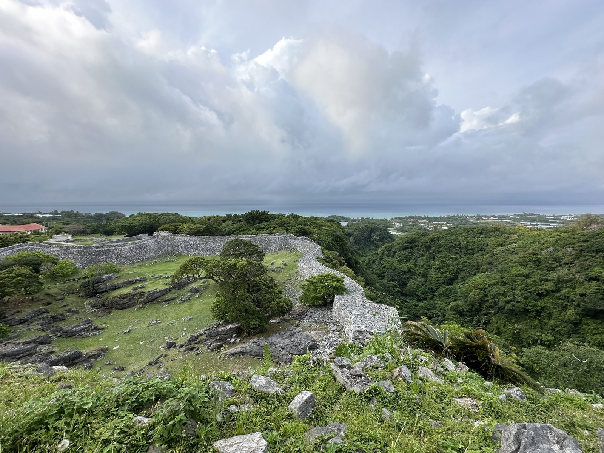

北部的景點都很值得，但離那霸遠。**早上七點前出發**，水族館開門就進去，下午才有時間慢慢走城跡和古宇利島。

## 08:30 美ら海水族館

一開門就進去，先直接去看黑潮之海大水槽（鯨鯊在這裡），十點以後團體客進來會很擠。看完大水槽再回頭看其他區。園區很大，海豚表演和海龜館在外面，**不用另外買票**。

## 中午：備瀨福木林道

水族館旁邊的小村子，兩邊都是幾百年的福木樹，路是白沙。可以租腳踏車，或走到底的海邊。夏天在樹蔭下比外面涼很多。

## 午餐：本部的沖繩麵

本部町是沖繩麵的一級戰區，老店中午排隊很正常。十一點半前到，或錯開到一點半以後。

## 下午：今歸仁城跡

世界遺產之一。城牆是彎彎曲曲的石灰岩，跟日本本島的城很不一樣。一月底到二月初有寒緋櫻，晚上偶爾有點燈活動。走完大約一小時。

## 傍晚：古宇利大橋與古宇利島

連著屋我地島和古宇利島的長橋，**開在橋上兩邊都是淺藍色的海**。過橋後島上有海灘和小店，繞島一圈大約 15 分鐘。橋頭的海灘可以停車拍照。

> 回那霸大約兩小時。高速入口在許田，天黑前出發比較輕鬆。

## 一天的節奏建議

| 時間 | 行程 | 移動 |
|---|---|---|
| 06:45 | 那霸出發 | 開車約 2 小時 |
| 08:30 | 美ら海水族館 | — |
| 11:30 | 備瀨福木林道 | 步行或開車 5 分鐘 |
| 12:45 | 本部吃沖繩麵 | 開車 10 分鐘 |
| 14:00 | 今歸仁城跡 | 開車 15 分鐘 |
| 15:30 | 古宇利大橋、古宇利島 | 開車 20 分鐘 |
| 17:00 | 回那霸 | 開車約 2 小時 |

不想一天來回，可以在名護或本部住一晚，隔天再接北部的山原森林。
