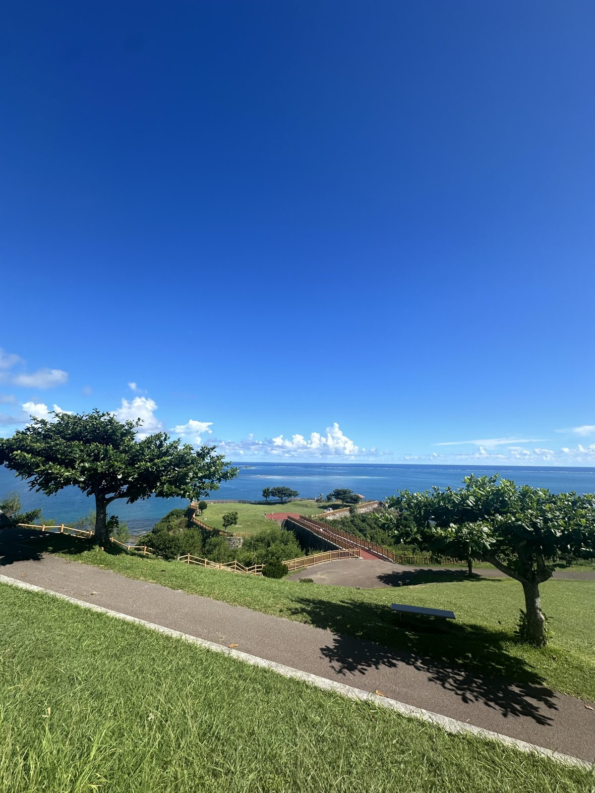

南部是沖繩最好排的一天。景點之間都在 15 分鐘車程內，最遠的南城從那霸開過去也只要 40 分鐘左右。不用早起趕路，晚上還能順路回機場附近。

## 上午：齋場御嶽（せーふぁうたき）

琉球王國最重要的聖地，現在是世界遺產。裡面沒有神殿，就是石灰岩、樹林和一道三角形的岩縫，穿過去能看到遠方的久高島。

- 售票在附近的「南城市地域物產館」，買完票再走過去
- **舊曆的特定日子會休園**（給當地人祭祀用），出發前查南城市的公告
- 這裡現在還有人在拜，碰到有人在祭祀，安靜繞過去

## 順路：ニライカナイ橋

從山上往海邊下坡的那條彎道橋。**從上往下開**的那一段，整片海會在前面打開。橋上不能停車，想拍照停在橋頭上方的展望處。

## 中午：知念岬公園

一片突出去的草地，前面就是海。沒有門票、沒有商店，坐在階梯上吹風就是全部的行程。旁邊的「がんじゅう駅・南城」可以休息買飲料。

## 下午：奧武島

靠一座短橋連著本島的小島。島上的天婦羅店是現點現炸，一個大概一百多圓，魚、花枝、紅芋都有，排隊很正常。吃完沿著海堤走一圈，十分鐘就繞完。

> 天婦羅很燙，店家會用紙袋裝。拿到海邊吃，風大的話小心被老鷹盯上。

## 傍晚：瀨長島ウミカジテラス

白色建築沿著山坡蓋在海邊，有咖啡、甜點和小店。這裡離那霸機場很近，**飛機會從頭上低低飛過**，夕陽時段特別熱鬧。

## 一天的節奏建議

| 時間 | 行程 | 移動 |
|---|---|---|
| 09:00 | 那霸出發 | 開車約 40 分鐘 |
| 09:45 | 齋場御嶽 | — |
| 11:15 | ニライカナイ橋 | 開車 5 分鐘 |
| 11:45 | 知念岬公園 | 開車 5 分鐘 |
| 13:30 | 奧武島（午餐＋天婦羅） | 開車 15 分鐘 |
| 16:30 | 瀨長島ウミカジテラス | 開車約 35 分鐘 |
| 18:30 | 回那霸或還車 | 機場 10 分鐘 |

不開車也能去：從那霸搭巴士到齋場御嶽大約一小時，但班次少，建議只排齋場御嶽＋知念岬，其他留到下次。
